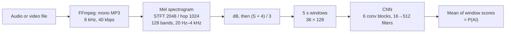

# BAMM: AI-generated music detection in real-world broadcast monitoring

Code, model weights and evaluation scripts for the ISMIR 2026 paper

> **Assessing AI-generated music detection in real-world broadcast monitoring**
> David López-Ayala, Fernando Garcia de la Cruz, Pablo Zinemanas, Emilio Molina, Martín Rocamora
> *Proc. of the 27th Int. Society for Music Information Retrieval Conf. (ISMIR)*, Abu Dhabi, 2026
> [arXiv:2608.07359](https://arxiv.org/abs/2608.07359)

The paper introduces **BAMM** (Broadcast AI-Music Monitoring), a dataset of real TV broadcast
clips that contain AI-generated or human-made music, and uses it to test two CNN detectors:

| Model | Trained on | Weights |
|---|---|---|
| **CNN Clean** | Clean foreground music: FMA-medium (human) vs SONICS Suno v3.5 (AI) | [`cnn_clean/`](https://huggingface.co/DaveLoay/bamm-cnn-detectors/tree/main/cnn_clean) |
| **CNN Broadcast** | The same music, 70% of it mixed with LibriSpeech speech at −30 to +30 dB SNR | [`cnn_broadcast/`](https://huggingface.co/DaveLoay/bamm-cnn-detectors/tree/main/cnn_broadcast) |

This repository contains:

- the training pipeline for both models (`pipelines/`, `configs/experiments/`)
- the script that builds the synthetic broadcast training set (`scripts/build_synthetic_broadcast_dataset.py`)
- inference on any audio or video file (`pipelines/predict.py`)
- the script that reproduces Table 1 and Figures 3–4 (`scripts/reproduce_paper.py`)
- the Deep Music Detector (DMD) foreground/background labels for BAMM (`metadata/bamm_dmd_segments.csv`)

## The BAMM dataset

BAMM holds 5,498 clips (3,009 AI, 2,489 human, 4 s to 60 s each) cut from TV channels
worldwide that aired between January 2025 and March 2026. Each clip is an MP4 file whose audio is
mono, 8 kHz AAC at about 42 kbps, the format of large-scale broadcast monitoring archives.

**Download:** Zenodo, link coming soon.

After unpacking it looks like this:

```
BAMM/
├── metadata.csv          id, file, label (human | ai), duration_s, sample_rate_hz, ...
└── audio/
    ├── ai/bamm_000001.mp4
    └── human/bamm_000004.mp4
```

`metadata/bamm_dmd_segments.csv` in this repository splits every clip into Deep Music Detector
segments (8,653 in total): `music` (foreground music, 3,359), `bgmusic` (background music, 5,225)
and `speech` (69). Columns: `id, segment_index, start_s, end_s, dmd_class, dmd_probability`.

## Quick start: score your own files

```bash
git clone https://github.com/DaveLoay/BAMM-dataset.git
cd BAMM-dataset
python -m venv .venv && source .venv/bin/activate
pip install -e .
python scripts/download_weights.py
python -m pipelines.predict --model-path weights/cnn_broadcast/model.h5 --input path/to/clip.mp4
```

You need `ffmpeg` on your `PATH` (`sudo apt install ffmpeg` or `brew install ffmpeg`), and
Python 3.10 or 3.11.

`--input` takes a file, a folder (add `--recursive`) or a `.txt` list of paths. Add
`--output-dir results/my_run` to write `predictions.jsonl` and `predictions.csv`. Each file gets a
`fake_score`, the mean of its 5 s window scores; the paper uses a threshold of 0.5.

If you only need the model, [`inference.py`](https://huggingface.co/DaveLoay/bamm-cnn-detectors/blob/main/inference.py)
on the Hugging Face page does the same thing in one file.

## How the models work



The CNN follows Afchar et al., *AI-generated music detection and its challenges*: six 3×3
convolution blocks with 16, 32, 64, 128, 256 and 512 filters, each followed by 2×2 max pooling
and batch normalisation, then global average pooling, a 128-unit dense layer and a sigmoid output
(1.64 M parameters). Both models share this architecture and preprocessing; only the training data
differs.

## Reproducing the paper results

You need the released weights, [AI-OpenBMAT](https://zenodo.org/records/20031232) for the STB
scenario, and BAMM for RTB. Unzip AI-OpenBMAT, which gives an `AI-OpenBMAT/` folder with `human/`
and `ai/` inside, then run:

```bash
python scripts/download_weights.py
python scripts/reproduce_paper.py \
    --openbmat-root /path/to/AI-OpenBMAT \
    --bamm-root /path/to/BAMM \
    --output-dir results/paper --workers 8
```

The CFM scenario uses the 476 + 476 clean reference tracks that AI-OpenBMAT was built from. They
are not publicly available, so by default the script skips CFM and runs STB and RTB. The CFM row
below comes from the authors' run; `--cfm-root` (a folder with `human/` and `ai/`) is how they
include it.

On CPU with 12 workers this takes about 25 minutes, and it writes to `results/paper/`:

| File | Content |
|---|---|
| `scores.csv` | One score per clip, model and subset |
| `metrics.csv` | Accuracy, precision, recall, F1 and ROC-AUC for every scenario and subset |
| `table1.md` | Table 1, plus the BAMM results per DMD segment |
| `figure3_roc_bamm.{pdf,png}` | ROC curves on BAMM: all segments, foreground, background |
| `figure4_histograms_bamm.{pdf,png}` | Score histograms on BAMM foreground and background segments |

`--plots-only` rebuilds the tables and figures from an existing `scores.csv`, and `--limit 10`
runs a quick check on 10 clips per class.

The three scenarios:

| Scenario | Data | Clips |
|---|---|---|
| CFM, Clean Foreground Music | Clean reference tracks of AI-OpenBMAT (not public) | 476 human, 476 AI |
| STB, Synthetic TV Broadcast | [AI-OpenBMAT](https://zenodo.org/records/20031232) `human/` and `ai/` | 3,294 (1,231 contain AI music) |
| RTB, Real TV Broadcast | BAMM | 5,498 clips, 8,653 DMD segments |

Expected output (F1 at threshold 0.5, ROC-AUC):

| Scenario | Unit | n | CNN Clean F1 | CNN Clean ROC | CNN Broadcast F1 | CNN Broadcast ROC |
|---|---|---|---|---|---|---|
| CFM | clip | 952 | 0.992 | 0.998 | 0.992 | 0.996 |
| STB | clip | 3,294 | 0.342 | 0.910 | 0.661 | 0.926 |
| RTB | clip | 5,498 | 0.186 | 0.761 | 0.472 | 0.796 |
| RTB | DMD segment, all | 8,653 | 0.172 | 0.707 | 0.422 | 0.775 |
| RTB | DMD segment, foreground | 3,359 | 0.317 | 0.782 | 0.519 | 0.858 |
| RTB | DMD segment, background | 5,225 | 0.039 | 0.667 | 0.338 | 0.745 |

How these map to the paper: the CFM and STB rows are Table 1. For RTB, Table 1 reports the F1
of the clip-level row (0.186, 0.472) and the ROC-AUC over all DMD segments (0.707, 0.775), the
same curves as the "All clips" panel of Figure 3. The foreground and background rows are the
other two panels of Figure 3. CNN Clean's STB ROC-AUC is 0.9097, printed as 0.909 in the paper.

In STB, the 416 AI-OpenBMAT mixtures from `data/ai/` whose annotation contains only `no-music`
segments hold no AI music. They count as negatives, as in the paper.

## Training the models

Training uses Docker, the TF 2.11 GPU image the paper models were trained with.

**1. Get the data** and put it in one folder:

| Folder | Source |
|---|---|
| `fma_medium/` | [FMA-medium](https://github.com/mdeff/fma) |
| `sonics_suno_v35/` | Suno v3.5 songs of [SONICS](https://huggingface.co/datasets/awsaf49/sonics) |
| `LibriSpeech/train-clean-360/` | [LibriSpeech](https://www.openslr.org/12) |

**2. Build the synthetic broadcast set** (CNN Broadcast only):

```bash
python scripts/build_synthetic_broadcast_dataset.py \
    --human-music-dir /data/fma_medium \
    --ai-music-dir /data/sonics_suno_v35 \
    --speech-dir /data/LibriSpeech/train-clean-360 \
    --output-dir /data/synthetic_broadcast \
    --mix-ratio 0.7 --snr-min-db -30 --snr-max-db 30 \
    --output-sample-rate 8000 --output-bitrate 40k --workers 8
```

For each class, 70% of the tracks are mixed with speech that spans the whole track (random
LibriSpeech utterances are concatenated until it is long enough), at an SNR drawn uniformly from
[−30, +30] dB. The other 30% are left clean. Everything is exported as mono 8 kHz MP3 at 40 kbps.

**3. Configure and build the image:**

```bash
cp .env.example .env      # set DATASETS_DIR=/data
make build
make gpu-check
```

**4. Run the four stages:**

```bash
make run-all EXP=configs/experiments/cnn_clean.yaml
make run-all EXP=configs/experiments/cnn_broadcast.yaml
```

| Stage | Target | What it does | Output |
|---|---|---|---|
| 1 | `make prepare` | Scans the audio and makes a stratified 70/20/10 split (seed 123) | `data/manifests/` |
| 2 | `make features WORKERS=8` | Computes one log-mel spectrogram per track | `data/features/` |
| 3 | `make train` | Trains with random 5 s crops (5 per track for CNN Clean, 3 for CNN Broadcast), Adam 1e-3, batch 50, up to 100 epochs, early stopping on validation loss; keeps the checkpoint with the best validation ROC-AUC | `data/artifacts/<name>/best_model.h5` |
| 4 | `make evaluate` | Scores the test split | `data/artifacts/<name>/eval/` |

Every value in `configs/experiments/cnn_*.yaml` matches the `config_snapshot.yaml` saved with the
released weights. Training is not bit-for-bit deterministic on GPU, so a retrained model will be
close to the released one but not identical.

MLflow is optional: leave `MLFLOW_TRACKING_URI` empty to skip it, or run `make up` and point it
at the server (see `.env.example`). To run without Docker, `pip install -e .` and call the same
modules directly, e.g. `python -m pipelines.train --config configs/experiments/cnn_clean.yaml`.

## Repository layout

```
configs/
  datasets/      fma_medium_sonics_suno_v35.yaml, synthetic_broadcast.yaml
  features/      mel_8k_128.yaml
  models/        spec_cnn_v1.yaml
  experiments/   cnn_clean.yaml, cnn_broadcast.yaml
pipelines/       prepare_data, extract_features, train, evaluate, predict
src/             config, data, features, models, training, evaluation, inference
scripts/         download_weights, build_synthetic_broadcast_dataset, reproduce_paper
metadata/        bamm_dmd_segments.csv
tests/           unit tests: make test, or pytest tests/
docker/          Dockerfile.gpu (TF 2.11, training), Dockerfile (CPU)
```

## Origin

This repository is a modified version of
[fergarciadlc/detector-models](https://github.com/fergarciadlc/detector-models) by
Fernando Garcia de la Cruz. It keeps that project's config-driven pipeline, has since diverged
from it, and is cut down to what the BAMM paper needs.

## Citation

```bibtex
@inproceedings{lopezayala2026bamm,
  title     = {Assessing {AI}-generated music detection in real-world broadcast monitoring},
  author    = {L{\'o}pez-Ayala, David and Garcia de la Cruz, Fernando and Zinemanas, Pablo
               and Molina, Emilio and Rocamora, Mart{\'i}n},
  booktitle = {Proc. of the 27th Int. Society for Music Information Retrieval Conf. (ISMIR)},
  address   = {Abu Dhabi, UAE},
  year      = {2026}
}
```

## License

The code is released under the [MIT License](LICENSE). The model weights and BAMM have their own
licenses, given on the [Hugging Face page](https://huggingface.co/DaveLoay/bamm-cnn-detectors) and
on Zenodo.

## Acknowledgments

This work is supported by the "Cátedra IA y Música" project (TSI-100929-2023-1), funded by the
Secretaría de Estado de Digitalización e Inteligencia Artificial, the European Union-Next
Generation EU funds and BMAT Music Innovators, and by the "IMPA" project (PID2023-152250OB-I00)
funded by MCIU/AEI/10.13039/501100011033/FEDER, UE.
